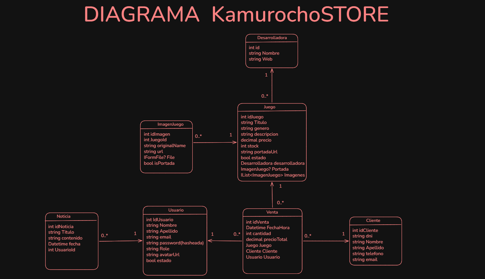
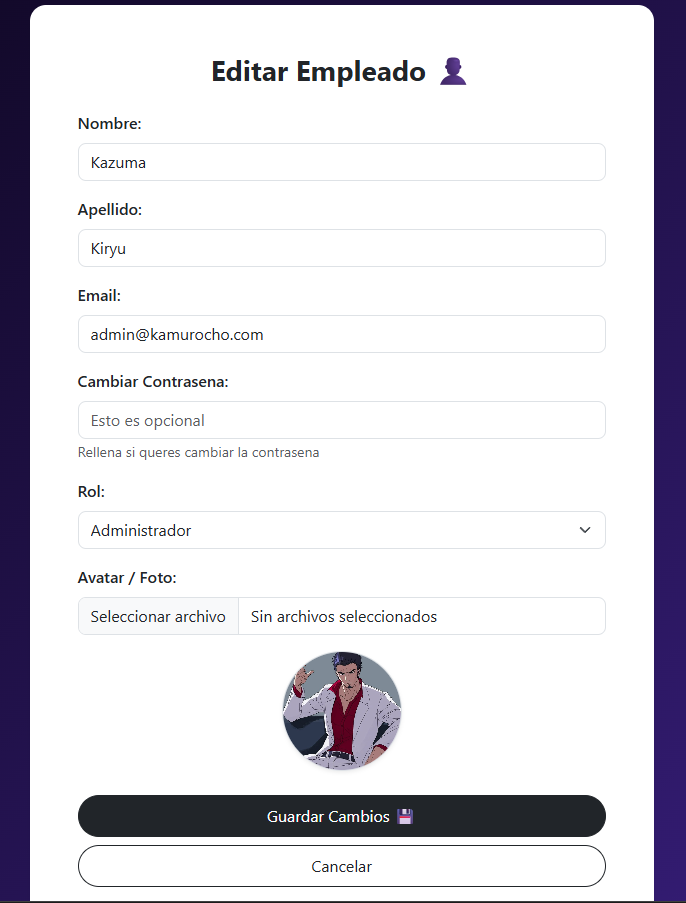
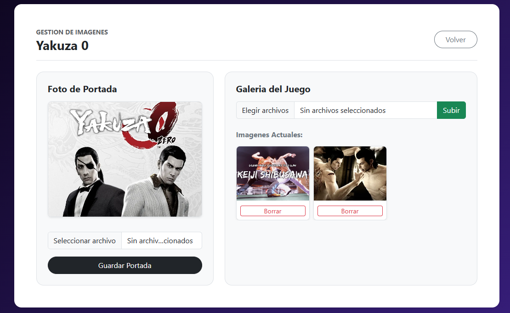
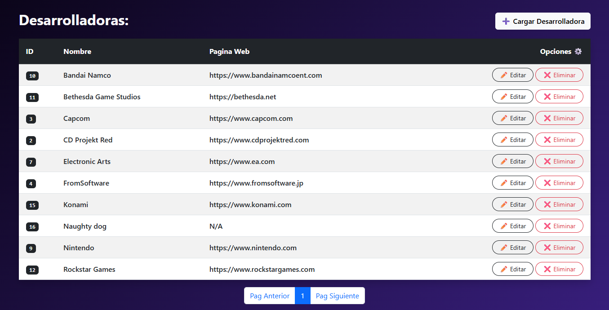
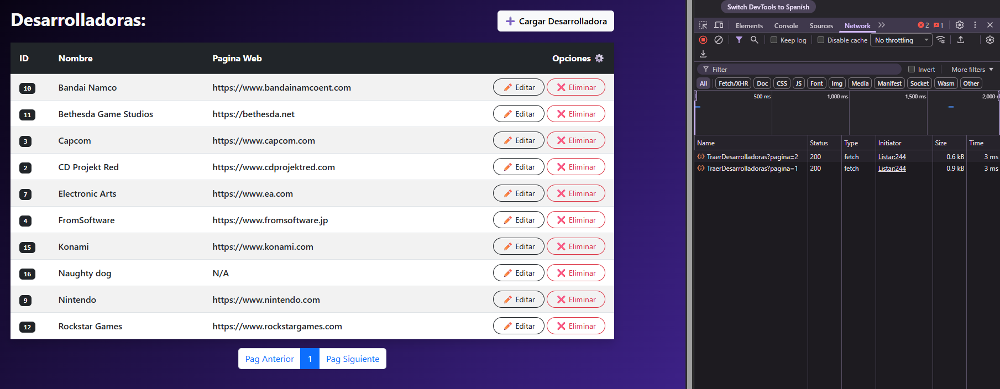
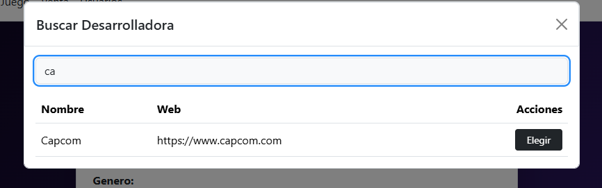
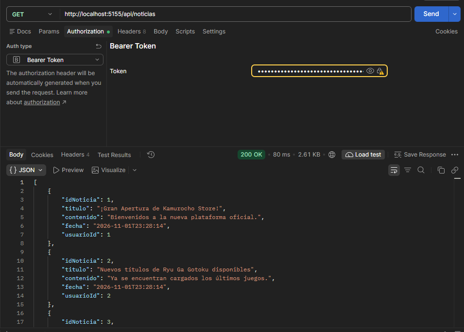

# 🐉 Kamurocho Store

Kamurocho Store es una página web desarrollada en **.NET (ASP.NET Core MVC)** para la materia **Laboratorio de Programación 2**. El sistema cumple con las funciones de gestión de clientes, catálogo de juegos, noticias internas, gestión de empleados y control de ventas.

---

## 👥 Integrantes
* Alejandro Peralta

---

## 🔑 Credenciales de Prueba

Para probar el sistema de forma rápida, podés utilizar las siguientes cuentas precargadas:

### 👑 Administrador
* **Email:** `majima@kamurocho.com`
* **Contraseña:** `12345`

### 💼 Empleado
* **Email:** `empleado1@kamurocho.com`
* **Contraseña:** `12345`

---

## 📊 Matriz de Evidencias

| Requerimiento Mínimo | Estado | Enlace al Código / Controladores | Evidencia (Captura / GIF / Video) |
| :--- | :---: | :--- | :--- |
| **1. 4 Tablas y Relación 1:N** | ✅ Cumplido | [/docs]|  |
| **2. Login, Roles y Avatar** | ✅ Cumplido | [Program.cs] [UsuarioController] |   |
| **3. Manejo de Archivos (Extra)** | ✅ Cumplido | [ImagenJuegoController.cs] [Views/Juego/Imagenes.cshtml] |   |
| **4. ABM en Vue.js + AJAX** | ✅ Cumplido | [DesarrolladoraController.cs] [Views/Desarrolladora/Listar.cshtml] |  |
| **5. Paginado por Servidor** | ✅ Cumplido | [JuegoController.cs] |  |
| **6. Selección Asíncrona (AJAX)** | ✅ Cumplido | [DesarrolladoraController.cs] [Views/Desarrolladora/Listar.cshtml] |  |
| **7. Web API + JWT** | ✅ Cumplido | [Program.cs] [Api/NoticiaController.cs] [UsuariosApiController.cs] |  |